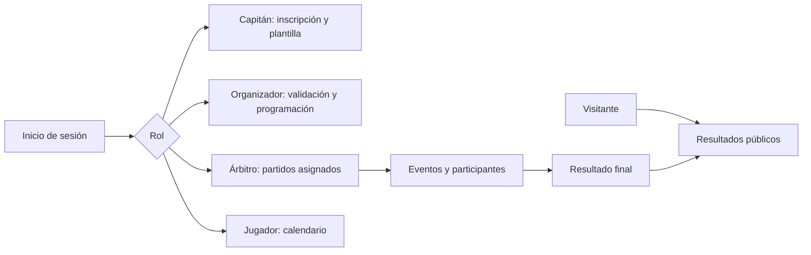

# 01. Guía de uso

## Propósito y acceso

Liga Amateur centraliza la administración de una temporada deportiva. Para navegar basta un navegador moderno con conexión al servidor publicado; las acciones privadas requieren sesión. La ruta pública de resultados no debe requerir inicio de sesión una vez implementado correctamente el control de acceso.

## Roles y permisos

| Rol funcional | Operaciones principales |
|---|---|
| Visitante / aficionado | Consultar resultados y detalles públicos de partidos publicados; otras vistas públicas solo si se implementaron. |
| Jugador | Consultar su calendario y, cuando estén disponibles, sus estadísticas y notificaciones. |
| Capitán | Inscribir equipo y plantilla, enviar correcciones, administrar altas/bajas y consultar calendario; pagos según módulo correspondiente. |
| Árbitro | Ver sus partidos asignados, iniciar y finalizar encuentros, registrar goles, asistencias, tarjetas y participantes. |
| Organizador | Validar inscripciones, gestionar jornadas y partidos, publicar calendario y administrar módulos según permisos. |

El esquema técnico contempla además el enum `ADMINISTRADOR`, pero su flujo de interfaz y permisos específicos no se presumen operativos sin verificación. El visitante no corresponde a un usuario autenticado con ese rol.

## Flujo A — Registro e inscripción (H1–H3)

1. Abrir `/login` e iniciar sesión. La creación de cuenta puede utilizar `POST /api/v1/users` si el frontend ofrece el formulario.
2. La cuenta debe contar con rol `CAPITAN` para inscribir un equipo; la asignación de ese rol es un proceso previo definido por la liga.
3. Entrar a `/equipos/inscripcion`; registrar nombre/sigla del equipo y los jugadores requeridos.
4. Enviar la inscripción y consultar el estado: `PENDIENTE_VALIDACION`, `APROBADO`, `RECHAZADO` o `SUSPENDIDO`.
5. Si el organizador rechaza la solicitud con observaciones, corregirla y reenviarla.
6. En el equipo aprobado, utilizar `/mi-equipo/plantilla` para altas y bajas dentro del período permitido.

**Organizador:** entrar a `/admin/inscripciones`, revisar solicitudes pendientes y aprobar o rechazar indicando el motivo. Las reglas del servidor prevalecen sobre la interfaz.

## Flujo B — Calendario (H4–H6)

1. El organizador ingresa a `/admin/partidos/nuevo` y crea jornadas de la temporada.
2. Programa encuentros entre equipos habilitados, indicando árbitro, cancha A/B/C, fecha y hora. Los encuentros duran 90 minutos programados, sujeto a las reglas del backend.
3. Publica una jornada para hacer visible el calendario.
4. Modifica, suspende o cancela únicamente los encuentros permitidos por sus estados, desde la vista de edición de partido.
5. El jugador/capitán consulta `/mi-equipo/calendario`, donde los datos se actualizan por polling HTTP aproximadamente cada cinco segundos.

## Flujo C — Árbitro y resultados (H7–H8)

1. La cuenta `ARBITRO` accede a `/arbitro/partidos` y visualiza únicamente las jornadas publicadas con encuentros asignados.
2. En `/arbitro/partidos/:id`, inicia un partido `PROGRAMADO`; pasa a `EN_CURSO`.
3. Registra goles, asistencias asociadas a un gol válido, amarillas y rojas; selecciona jugador y minuto.
4. Marca a todos los participantes, aunque no hayan marcado o recibido tarjetas, para estadísticas posteriores.
5. Finaliza el encuentro; el marcador se calcula a partir de los eventos `GOL` y el resultado queda oficial.
6. En `/resultados`, cualquier persona puede consultar la lista pública. En `/resultados/partidos/:id` ve equipos, resultado e incidencias cronológicas cuando el despliegue de H8 esté operativo.

> Los eventos se rechazan fuera de `EN_CURSO`, y un árbitro no asignado recibe una prohibición. El cronómetro del panel es una visualización del tiempo transcurrido; no debe confundirse con el registro oficial de eventos.

## Diagrama de navegación principal

## Mensajes y posibles incidencias

- **401:** sesión ausente, caducada o no válida.
- **403:** rol no autorizado o árbitro no asignado al encuentro.
- **400:** datos inválidos; consultar el detalle del formulario.
- **404:** equipo, jugador o partido inexistente.
- **409:** conflicto de reglas: período cerrado, estado no editable o transición no permitida.
- **500/502:** problema del servidor o su conexión con la base de datos; véase [problemas conocidos](09-problemas-conocidos.md).

## Evidencias gráficas

La guía oficial solicita capturas. No se incorporan capturas ficticias como si fueran del sistema ejecutándose. Para evidencias reales de esta entrega se deben guardar vistas de: inscripción, revisión de solicitudes, calendario, panel del árbitro y resultados públicos. Los mockups proporcionados durante el desarrollo describen el diseño, pero no sustituyen por sí solos una captura del despliegue funcional.

## Capturas requeridas para completar la entrega

La cátedra solicita capturas de los flujos principales. Agregar imágenes auténticas en `docs/assets/` y enlazarlas desde esta guía. Como mínimo:

1. Inicio de sesión.
2. Inscripción de equipo y plantilla.
3. Bandeja de validación del organizador.
4. Programación/publicación de una jornada.
5. Calendario de equipo.
6. Panel del árbitro con marcador/eventos.
7. Resultados públicos.
8. Pagos, notificaciones y reportes, si se incluyen en la versión desplegada.

No presentar mockups como capturas del sistema en producción. Si se usan mockups para explicar un flujo, identificarlos explícitamente como diseño.
