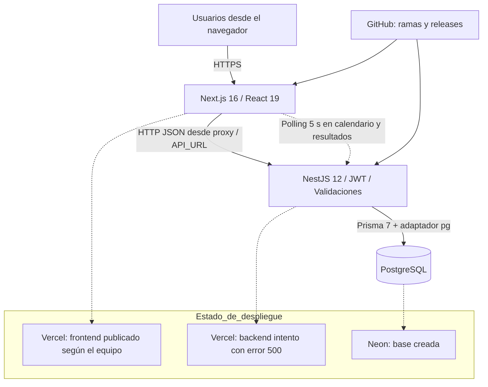
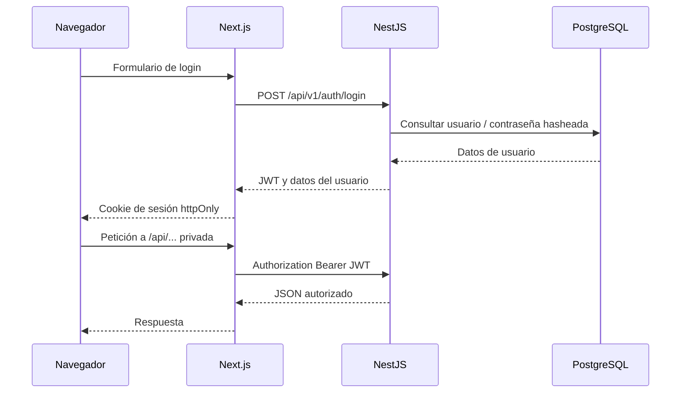

# 02. Arquitectura del sistema

## Visión general

La plataforma está separada en aplicación web (frontend), API REST (backend) y persistencia relacional. Esta separación facilita desarrollar historias por módulos, gestionar permisos en un único punto y desplegar cada componente de forma independiente.



El diagrama diferencia la arquitectura lógica de su **estado de publicación**: al momento de documentar, la API alojada en Vercel aún registraba una excepción de ejecución. La opción futura puede cambiarse sin alterar el diseño del sistema.

## Stack técnico comprobado en los archivos compartidos

| Capa | Tecnología | Función |
|---|---|---|
| Interfaz | Next.js 16.3.6 + React 19 | Páginas, formularios y rutas dinámicas |
| Lenguaje | TypeScript | Tipado compartido dentro de cada proyecto |
| Estilos | Tailwind CSS, Lucide | Componentes y elementos visuales |
| Consultas | TanStack Query | Fetch, caché, invalidaciones y polling |
| API | NestJS 12 | Controllers, servicios, repositorios, guards, DTO y Swagger |
| Persistencia | Prisma 7.10 + `@prisma/adapter-pg` | ORM tipado y migraciones |
| Base de datos | PostgreSQL 18 en desarrollo | Relaciones, índices y transacciones |
| Autenticación | JWT + refresh token | Sesiones, autorización por rol |
| Desarrollo local | Docker Compose | Servicio PostgreSQL y opcionalmente API |
| Código y despliegues | Git / GitHub | Ramas feature, integración y versiones |

## Organización del backend

```text
src/
├── admin-payments/       # consulta de cuotas y suspensión/reactivación
├── auth/                 # login, refresh, logout, guards y decoradores
├── common/               # decoradores y utilidades compartidas
├── config/               # validación de variables de entorno
├── health/               # health check público
├── matches/              # jornadas, partidos, marcador, resultados y tabla
├── notifications/        # servicio interno de notificaciones
├── payments/             # servicios/repositorios de pagos
├── player-stats/         # estadísticas individuales
├── prisma/               # módulo y PrismaService
├── ranking/              # ranking de jugadores
├── registration-payments/# pago simulado de inscripción
├── teams/                # equipos, jugadores y plantilla
├── users/                # registro de usuarios
├── app.module.ts         # composición de módulos y guards globales
└── main.ts               # bootstrap, prefijo /api/v1 y Swagger
prisma/
├── migrations/
├── schema.prisma
├── seed.ts
└── prisma.config.ts      # configuración del CLI de Prisma
```

Convención general: **Controller → Service → Repository → PrismaService → PostgreSQL**. Las validaciones de la API se hacen mediante DTO y `ValidationPipe`; los guards globales verifican JWT y roles, salvo rutas señaladas expresamente como públicas.

## Organización del frontend

```text
app/         # App Router: login, admin, arbitro, mi-equipo, resultados
components/  # layout y componentes por módulo
hooks/       # coordinación de estado y formularios
queries/     # TanStack Query: consultas y mutaciones
services/    # llamadas HTTP
lib/api/     # cliente/proxy y manejo de errores
types/       # contratos TypeScript
```

El frontend utiliza una cookie `httpOnly` llamada `session`. Las peticiones privadas pasan por la ruta interna `/api/[...path]`, que lee la cookie en el servidor y reenvía el `Authorization: Bearer` al backend. El login se ejecuta mediante Server Actions para evitar exponer los tokens al JavaScript del navegador. El ZIP de frontend revisado contiene las pantallas de inscripción, administración, calendario y arbitraje; la ruta pública H8 debe comprobarse en el `main` definitivo.

## Secuencia de autenticación



## Decisiones técnicas y justificación

- **Separación frontend/backend:** permite desplegar aplicaciones por separado y reutilizar la API.
- **Prisma + repositorios:** concentra consultas y reduce acoplamiento en servicios de negocio.
- **JWT + guards:** exige permisos en backend, independientemente de la navegación visual.
- **Polling de 5 segundos:** responde al criterio de aceptación sin desplegar WebSockets.
- **Prisma Migrate:** mantiene un historial reproducible de cambios de base de datos.
- **Archivos `.env` fuera del repositorio:** reduce exposición de secretos.

## Restricciones

Las instancias serverless pueden requerir adaptar el bootstrap de NestJS y la carga de módulos ESM. El código compartido usa `src/main.ts` como arranque de servidor tradicional; por ello, un build exitoso en Vercel no demuestra que la API se ejecute correctamente. Véase [despliegue](06-despliegue.md) y [problemas conocidos](09-problemas-conocidos.md).


## Configuración transversal del backend

- Prefijo global: `api/v1`.
- Swagger: `api/docs`.
- `ValidationPipe`: `whitelist`, `forbidNonWhitelisted` y `transform`.
- Guards globales: `JwtAuthGuard` y `RolesGuard`; las rutas públicas se declaran con `@Public()`.
- El proyecto usa ESM (`type: module`); los imports relativos compilados incluyen `.js` y el build ejecuta `tsc-alias`.
- Prisma 7 utiliza `@prisma/adapter-pg` para conectarse a PostgreSQL.
