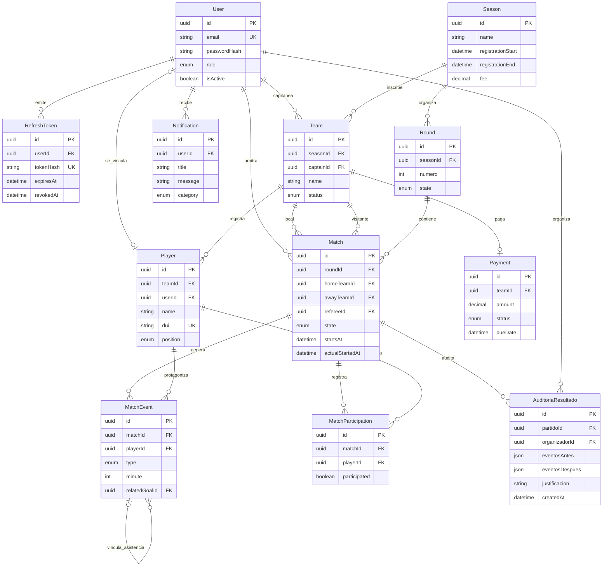

# 03. Modelo de datos

## Fuente de verdad

El esquema Prisma se localiza en `prisma/schema.prisma`. Este resumen se basa en el esquema incluido en el ZIP del backend y en los cambios de H7 y contrato de notificaciones H20/H21 compartidos posteriormente. Si se incorporaron más modelos por los demás integrantes, el esquema de `main` prevalece sobre este documento.

## Diagrama entidad-relación

## Descripción de tablas

| Modelo / tabla SQL | Descripción | Aspectos clave |
|---|---|---|
| `User` / `users` | Cuenta con correo, contraseña hasheada y rol. | Correo único; relación opcional 1:1 con `Player`. |
| `RefreshToken` / `refresh_tokens` | Sesiones renovables con token hasheado. | Revocación y caducidad. |
| `Season` / `seasons` | Temporada, calendario y ventanas de inscripción/plantilla. | Cuota de inscripción, temporada activa. |
| `Team` / `teams` | Equipo inscrito por capitán en temporada. | Nombre/sigla y capitán únicos por temporada. |
| `Player` / `players` | Ficha de jugador, posición, dorsal y fecha de baja. | DUI único; dorsal único por equipo. |
| `Payment` / `payments` | Cuota de inscripción de cada equipo. | Relación 1:1 por `teamId`, estado y vencimiento. |
| `Notification` / `notifications` | Avisos dirigidos a usuarios. | Estado leído, categoría, módulo origen e idempotencia por evento/destinatario. |
| `Round` / `rounds` | Jornada y publicación. | Número único por temporada. |
| `Match` / `matches` | Encuentro con dos equipos, cancha, árbitro, fechas y estado. | Horario planificado y horario real opcional de inicio/fin según extensión H7. |
| `MatchEvent` / `match_events` | Gol, asistencia, amarilla y roja con minuto. | `relatedGoalId` solo en asistencia. |
| `MatchParticipation` / `match_participations` | Jugadores que disputaron un encuentro. | Un registro por pareja `(matchId, playerId)`. |
| `AuditoriaResultado` / `auditorias_resultado` | Auditoría de correcciones de resultados. | Conserva organizador, eventos antes/después, justificación y fecha. |

## Enumeraciones relevantes

- `Role`: `JUGADOR`, `CAPITAN`, `ARBITRO`, `ORGANIZADOR`, `ADMINISTRADOR`.
- `TeamState`: `PENDIENTE_VALIDACION`, `APROBADO`, `RECHAZADO`, `SUSPENDIDO`.
- `Position`: `PORTERO`, `DEFENSA`, `MEDIOCAMPISTA`, `DELANTERO`.
- `PaymentState`: `PENDIENTE`, `PAGADO`, `VENCIDO`.
- `RoundState`: `BORRADOR`, `PUBLICADA`.
- `MatchState`: `PROGRAMADO`, `EN_CURSO`, `FINALIZADO`, `SUSPENDIDO`, `CANCELADO`.
- `MatchEventType`: `GOL`, `ASISTENCIA`, `AMARILLA`, `ROJA`.
- `NotificationState`: `NO_LEIDA`, `LEIDA`.
- Extensión H20/H21: `NotificationCategory` (`PAGOS`, `CALENDARIO`, `RESULTADOS`, `INSCRIPCIONES`) y `NotificationSourceModule` (`INSCRIPCIONES`, `CALENDARIO`, `RESULTADOS`, `PAGOS`).

## Reglas de integridad

1. Los equipos locales y visitantes deben estar habilitados para jugar y ser diferentes.
2. Un árbitro asignado corresponde a una cuenta autorizada con rol `ARBITRO`.
3. Solo jugadores de los equipos contendientes pueden aportar eventos y participaciones.
4. Las asistencias están relacionadas con un evento `GOL` válido.
5. El marcador se deriva del conteo de eventos `GOL`, no de un campo editable independiente.
6. La restricción única de participaciones evita duplicidades por encuentro/jugador.
7. La extensión de notificaciones evita avisos duplicados por combinación `(eventId,userId)`.

## Migraciones

La evolución del esquema se encuentra versionada en `prisma/migrations/`. Para una base nueva, se ejecuta `npm run prisma:deploy`. **No ejecutar `prisma migrate reset` en producción.** Una de las migraciones de notificaciones presentó un carácter BOM en el archivo SQL; se corrigió localmente, pero debe verificarse en `main` antes del despliegue.

## Diferencias que deben cotejarse con la versión final de `main`

En el ZIP de backend revisado se encontraron los modelos enumerados arriba. No se encontraron modelos Prisma `Media` ni `NotificationPreference`; tampoco un modelo separado de reportes, porque las posiciones/estadísticas pueden calcularse mediante consultas. Si H18–H19 o H21–H23 se integraron después en `main`, actualizar este diagrama con el `schema.prisma` definitivo. En el esquema inspeccionado, `NotificationCategory` incluye `PAGOS`, `CALENDARIO`, `RESULTADOS` e `INSCRIPCIONES`; `NotificationSourceModule` incluye `INSCRIPCIONES`, `CALENDARIO`, `RESULTADOS` y `PAGOS`.
