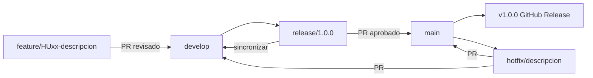

# 07. Forma de trabajo y Git Flow

## Organización

El equipo Tres Tristes Tigres divide el trabajo por historias aprobadas, con repositorios independientes para frontend y backend y un tablero Trello de seguimiento. Las historias H1–H8 están asignadas a José Miguel Ramírez Ramírez, H9–H15 a Orlando Antonio Valdez Sibrian y H16–H23 a Stephanie Aracely Echeverria Cuellar.

## Flujo de ramas requerido



El flujo exigido por la cátedra es: rama por historia, PR aprobado por **otro integrante**, fusión en `develop`, release desde `develop`, PR hacia `main` y regreso a `develop`. Crear la etiqueta `v1.0.0` en ambos repositorios; no basta con nombrarla en la documentación.

## Convención de ramas

- `feature/HU6-Consulta-Calendario-Partidos`
- `feature/HU7-Marcador-En-Vivo-Eventos-Partido`
- `feature/HU8-Consulta-Resultados-Oficiales-Vista-Publica`
- `release/1.0.0`
- `hotfix/<descripcion>`

Los ejemplos anteriores representan las ramas trabajadas durante el proyecto. El nombre concreto en GitHub es la referencia definitiva.

## Convención de commits adoptada

Gitmoji con un tipo explícito de cambio:

```bash
git commit -m ":sparkles:[CREATE]Agrega formulario de eventos del partido HU7"
git commit -m ":bug:[FIX]Corrige validacion de minutos HU7"
git commit -m ":memo:[UPDATE]Actualiza DTO del calendario HU6"
git commit -m ":lipstick:[CREATE]Incorpora vista publica de resultados HU8"
```

Cada commit debe ser cohesivo, incluir la historia cuando corresponda y evitar secretos o artefactos generados. Los commits por archivo son útiles si no fragmentan una corrección en un estado imposible de compilar.

## Pull Request y revisión

1. Confirmar que la rama parte de `develop` actualizado.
2. Ejecutar compilación y pruebas relevantes.
3. Publicar la rama (`git push -u origin <rama>`).
4. Crear PR hacia `develop` y describir: historia, alcance, archivos, evidencia y límites.
5. Pedir aprobación a otro integrante; resolver observaciones.
6. Fusionar el PR, actualizar tarjeta en Trello y agregar enlace al PR.
7. Conservar en `main` solo lo incluido en release verificada.

## Enlaces de seguimiento

- [PR del backend](https://github.com/Stxphaniee/be_boilerplate_is_2026/pulls)
- [PR del frontend](https://github.com/Stxphaniee/fe_boilerplate_is_2026/pulls)
- **Tablero Trello:** el enlace del equipo no figura en los materiales disponibles; no se inventa una URL.

## Roles de revisión y transparencia

Los PR deben quedar en GitHub con revisor y aprobación verificables. Los merges directos ejecutados durante el desarrollo no se describen como PR aprobados si no existe registro. En [08-historias](08-historias.md) se separan los avances reportados de los respaldos pendientes.
